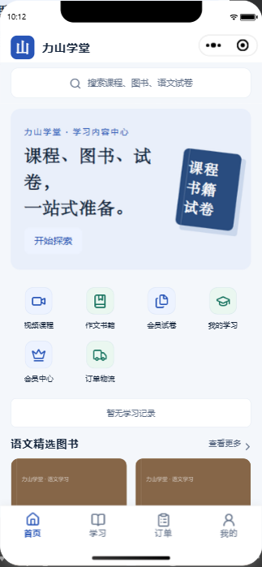
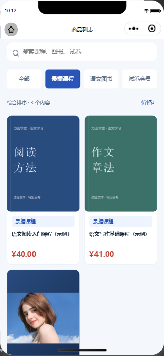
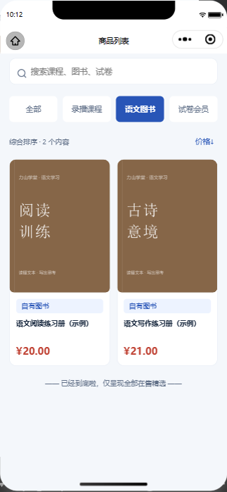
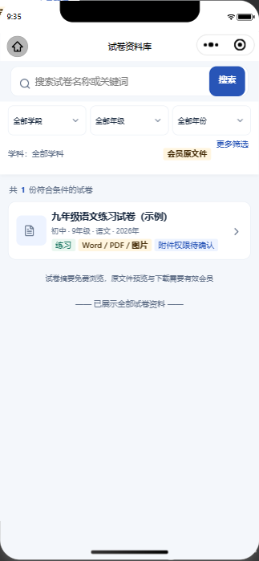

# 力山学堂

面向语文教学的微信小程序，支持视频课程售卖、自营作文书销售和会员试卷下载，配套 Vue 管理后台与 Java 后端。

## 小程序界面

以下为 2026 年 10 月开发预览截图，内容与价格为示例数据。点击图片可查看大图。

<table>
  <tr><th>首页</th><th>视频课程</th><th>图书商城</th><th>会员试卷</th></tr>
  <tr>
    <td width="25%"></td>
    <td width="25%"></td>
    <td width="25%"></td>
    <td width="25%"></td>
  </tr>
</table>

## 功能与技术

- 微信小程序：课程浏览与学习、图书购买、会员试卷、订单售后、学习记录及个人中心。
- 管理后台：内容与素材管理、商品与库存、订单售后、会员、分销及经营统计。
- 技术栈：uni-app / Vue 3 / TypeScript、Java 21 / Spring Boot、MySQL 8 / Flyway、Docker Compose。

## 工程入口

| 目录 | 内容 |
| --- | --- |
| [frontend](frontend/README.md) | 管理后台、小程序、共享领域模块，npm workspaces |
| [backend](backend/README.md) | 后端服务、数据库迁移、配置模板与测试 |
| [docs](docs/README.md) | 需求基线、接口约定、微信配置指南 |

## 开发与部署

1. 按[后端说明](backend/README.md)配置专用数据库与本地配置，运行 backend/start-local.cmd。
2. 在 frontend 执行 npm ci，再按[前端说明](frontend/README.md)启动管理后台或 H5。
3. 微信端构建后，将 frontend/miniprogram/dist/build/mp-weixin 导入微信开发者工具。

[部署维护](backend/docs/deployment.md)说明服务器更新、配置、密钥与恢复方式。微信登录、支付和转账分别配置；商户支付配置及真实渠道验收尚未完成。需求文档中的功能范围不代表所有功能均已通过线上验收。

仓库保存源码、必要素材、测试、锁文件及配置模板。本地数据库、上传文件、密钥、依赖与编译产物不入库。源码更新不会同步本地和服务器的数据。
