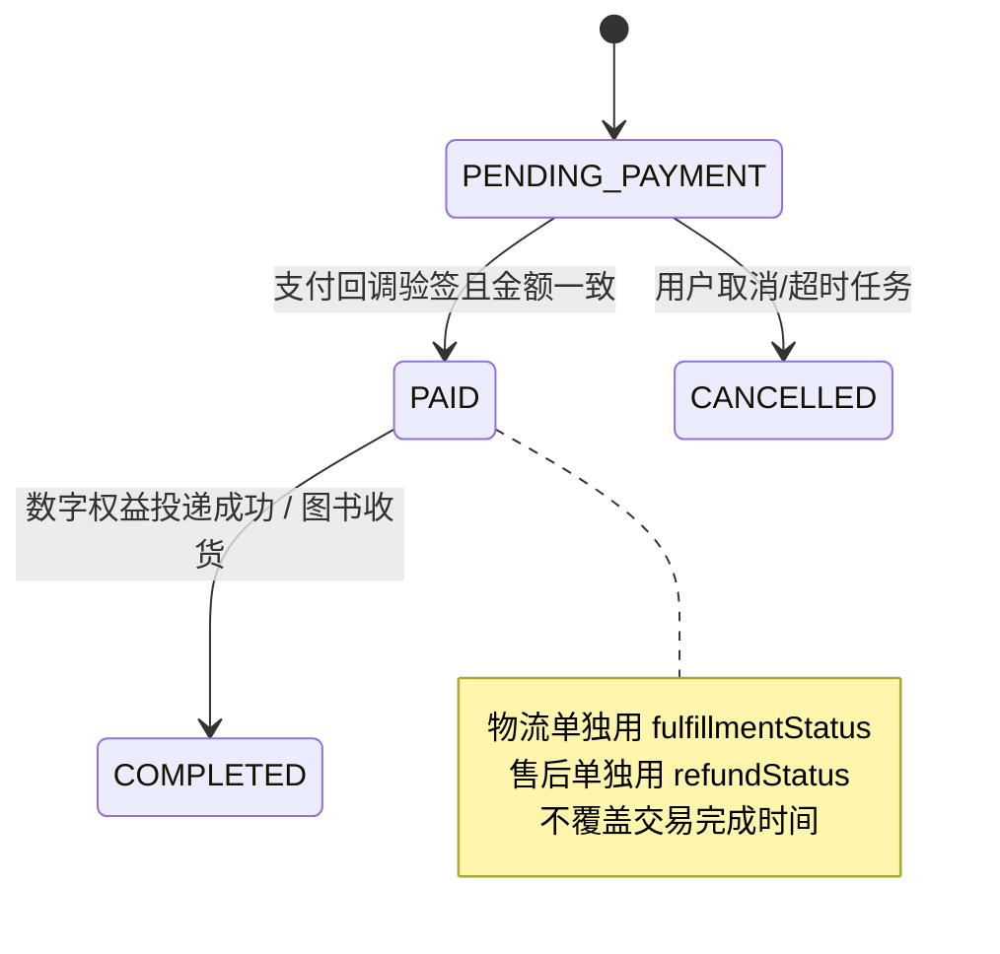
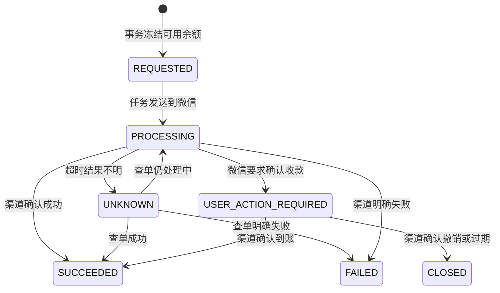

# 教学内容商城小程序后端开发需求文档

> 本文为业务需求基线；当前结构和运行方式见项目 README。
>
> 后端目录：`backend/`
>
> 文档版本：v1.1（2026-10-08）
>
> 适用人员：Java 后端、前端联调、部署和运营后台开发人员

## 1. 目标、已确认规则和边界

### 2026-10-08 确认：负责人分工与数据查看范围

**管理后台从阶段 0 开始就在范围内。** 后端负责人负责 `backend/` 中 Java 工程、数据库迁移、用户/管理员会话与权限、顾客/管理 API、统计聚合、任务、审计和渠道适配；前端负责人负责小程序和 Web 管理后台的所有页面、交互与构建。后端阶段0提供管理员登录/权限契约及开发数据，随后按阶段交付管理接口，无需等待后台 UI 完成才开发领域逻辑。

已确定：订单、销售额、退款、会员、佣金、提现在自建后台查看；访问人数/次数/新访问用户由运营在微信公众平台查看。首期不接微信小店，不开发微信访问数据同步任务，不新增访客统计 API、visit 表或采集埋点。业务必须的 `referral_touch` 分销归因和下载授权审计继续保留，不扩展成访客统计。

后端维护 OpenAPI 和同格式示例，前端据此用 fixtures 并行开发。只修改负责目录；接口字段、状态和金额口径不得单方面改变。共享文档所有权和接口交接按《接口契约与联调约定》第 12 节执行。

2026-10-08确认补充：小程序正式名称“力山学堂”，介绍“学习，是自己的事情！”，沿用客户图2现有头像与账号。首页初始化八入口为课程评价、古诗文、记叙文、说明文、议论文、名著导读、作文、教研中心，目标使用已定义的内容/列表，不扩展作文修改或评价业务。微信小店为独立产品，本系统上线不等于开通小店，订单、会员、课程、佣金不自动同步过去；经营指标继续取自本系统交易/权益流水。访客统计若后续接入须单列来源、口径、时间范围和更新时间，不能把平台首次访问人数等同本系统注册人数。认证到期为截图状态，当前是否续期仍需客户核实。

配套阅读：[交付与阶段总览](README.md)、[共享接口契约](接口契约与联调约定.md)、[前端页面需求](前端开发需求文档.md)。第 10 章规定业务边界，第 11 章提供数据库实施细节，第 13 章提供验收场景。

后端采用 Java 21、Spring Boot 3（建议与旧项目保持 Spring Boot 3.5.6）、Spring Security、Spring Data JPA、MySQL 8、Flyway，按模块化单体部署。首期不拆微服务；课程、商品、会员、交易、分销在一个应用内通过领域服务和明确事务边界协作。本文为交给开发者的需求设计，不是已经实现/运行的系统。推荐先读第1章范围、第7章阶段，再读业务与数据库细节。

客户已确认的规则：

1. 课程是录播课程，可以有多个章节，按课程单独购买；每个课程后台配置购买后的观看有效期；试卷会员不自动包含付费视频课程。
2. 试卷会员只有一个会员等级，至少有半年和一年两种套餐；有效期内可下载全部会员试卷，文件格式包括 Word、PDF 和图片；未到期续费从原到期日顺延。
3. 实体图书在线销售，记录地址、库存、发货和快递单号，用户可以查询物流进度。
4. 首页由后台配置三张轮播图、八个快捷入口和可排序内容模块。
5. 一级分销：每个商品可以指定一个或多个分销员及佣金比例；分享链接/小程序码用于归因；订单完成并经过售后期后佣金可结算；退款会冲减佣金；分销员必须支持线上自动提现。
6. 后台需要查看经营数据。

以下是可执行的首期设计默认值，不代表客户逐项指定；阶段 0 由负责人检查，正式运营参数上线前填写：每单一种商品（图书可多本），不混单、不做购物车；一张图书订单一个包裹；课程有效期内不重复购买，到期后可重购；一级分销采用商品范围内最近有效触点、30 天归因窗口；售后观察期为 7 天。首期不开发优惠券、评价、圈子、直播、打卡、考试或自动续费。实体图书、会员、课程、分销和自动提现均为必交付。

自动提现首期采用“分销员发起提现→系统校验→系统转账；微信要求时由用户确认收款”，普通合格提现不需要人工逐笔付款。授权免确认收款作为后续能力，不能承诺任何场景都无需用户操作。物流、存储、视频供应商及正式价格、运费、提现限额由客户/部署方提供，开发文档不擅自选购付费服务。

参考小程序的 H5 前端资源、编译 JS 和观察到的 URL 不是本系统的后端实现，也不是可用的接口契约。不得复制其平台接口、猜测其数据库或把第三方 JS 当作本项目服务端逻辑。

## 2. 工程和模块

### 2.1 固定技术

| 项目 | 方案 |
|---|---|
| JDK | Java 21 |
| Web | Spring Boot 3，建议 3.5.6 |
| 安全 | Spring Security + 数据库会话的随机不透明 Bearer token；数据库只存 SHA-256 token 哈希，沿用旧项目方向，不引入 JWT |
| ORM | Spring Data JPA，领域查询不足时使用明确的 JPQL/Specification；不混用另一套持久层 |
| 数据库 | MySQL 8，UTC 存储时间并按 Asia/Shanghai 展示 |
| 迁移 | Flyway，所有表结构和索引通过版本化 SQL |
| API 文档 | SpringDoc/OpenAPI，接口契约同步 `docs/接口契约与联调约定.md` |
| 构建 | Maven；测试使用可复现的 MySQL/Testcontainers 或专用测试库 |
| 架构 | 模块化单体，单应用/单数据库，模块内部控制事务和依赖方向 |

### 2.2 建议包结构

```text
backend/src/main/java/.../
├─ common/                 # 响应、异常、金额/时间、审计、幂等、文件授权
├─ auth/                   # 用户登录、管理员、角色权限
├─ homepage/               # 轮播、快捷入口、内容区块
├─ catalog/                # 分类、商品、封面、上下架
├─ course/                 # 课程、章节、播放权限、学习进度
├─ paper/                  # 试卷、文件、会员可见性
├─ membership/             # 套餐、会员权益、续费
├─ order/                  # 订单、订单项、库存、售后
├─ payment/                # 支付抽象、回调、退款
├─ fulfillment/            # 地址、发货、物流
├─ distribution/           # 分销归因、佣金、提现
├─ analytics/              # 经营指标和报表
└─ admin/                  # 管理接口、后台权限、操作日志
```

模块依赖方向：`order` 可以调用 `catalog/course/membership/distribution` 的领域服务生成快照和权益事件；各业务模块不能直接修改其他模块的表。跨模块改变使用应用服务和领域事件/可靠任务表，避免支付回调内嵌过多逻辑。

## 3. 统一接口和安全要求

### 3.1 URL、响应和分页

- 外部接口前缀 `/api/v1`；后台接口前缀可以使用 `/api/v1/admin`，但响应结构相同。
- 成功响应：`{ "code": "OK", "message": "", "data": ... , "requestId": "..." }`。
- 失败响应：`{ "code": "ORDER_STALE", "message": "订单价格已变化", "data": null, "requestId": "..." }`。
- 列表：`{ "items": [], "page": 1, "pageSize": 20, "total": 0 }`；后端限制最大 `pageSize`。
- 金额使用整数分字段 `amountFen`；佣金比例使用基点 `rateBps`（1%=100 bps）；不得使用数据库浮点金额。
- 时间用 ISO-8601 带时区字符串传输，数据库使用 `Instant`/UTC；业务到期日的计算按商城配置时区（默认 Asia/Shanghai）。
- 错误码、DTO 和状态枚举以共享文档为准；新增字段向后兼容，删除字段必须升版本。

### 3.2 鉴权和权限

- 顾客 token 只能访问自己的订单、地址、学习、会员、下载和佣金数据；资源 ID 不得替代权限检查。
- 管理员使用角色权限：至少 `CONTENT_EDITOR`、`ORDER_OPERATOR`、`FINANCE_OPERATOR`、`DISTRIBUTION_OPERATOR`、`ANALYST`、`SUPER_ADMIN`。敏感操作额外要求操作原因和审计。
- 开发登录只在 `dev/test` profile 注册；生产启动检查禁止 dev login。
- 真实小程序登录由服务端通过 AppID 与微信接口换取身份，AppSecret 永不下发前端；身份以 (app_id,openid) 加唯一约束；unionid 作为可空辅助关联，不跨 AppID 自动合并。
- 下载、播放和上传使用后端签发的短时效 URL 或代理流；不把对象存储长期地址写入公开接口。
- 对用户手机号、地址、微信标识、支付信息和文件 URL 进行最小化日志记录；日志中脱敏。

### 3.3 幂等、并发和任务

- 创建订单、支付确认、退款、发货、佣金生成、提现申请和微信回调均有幂等键/外部单号唯一约束。
- 回调先落库原始事件和签名验证结果，再在事务中推进状态；重复回调返回已处理结果。
- 库存扣减使用条件更新或乐观锁；付款超时关闭、售后期结算、物流同步、转账查询采用可重试任务。
- 外部调用超时后状态设为 `PROCESSING/UNKNOWN`，通过查询接口恢复；不能根据网络异常直接认定失败或成功。
- 涉及金额和权益的事务写审计/业务流水，补偿任务只能产生反向流水，不能覆盖历史记录。

## 4. 领域和数据库设计

本章给出领域实体，第 11 节补充字段类型、索引和迁移。物理表避免关键字：order 使用 store_order。所有实体有 id、created_at、updated_at，可修改实体加 version；财务流水不更新/软删除。首期商品只有 COURSE、BOOK、MEMBERSHIP；试卷只通过会员访问，公开专题使用 article。

### 4.1 账户与权限

| 表 | 关键字段和约束 |
|---|---|
| `user_account` | `id`、昵称、头像、手机号（加密/脱敏展示）、状态、注册时间；手机号可为空，注销后保留不可逆匿名化记录 |
| `user_wechat_identity` | `user_id`、`app_id`、`openid`、`unionid`、最后登录时间；`(app_id,openid)` 唯一 |
| `admin_user` | 登录名、密码哈希、状态、最后登录；不得存明文密码 |
| `admin_role` / `admin_user_role` / `admin_permission` | 角色和细粒度权限；敏感接口服务端强制校验 |
| `login_session` | token 哈希、用户、过期时间、撤销时间、设备摘要；不存可直接使用的明文 token |

### 4.2 首页装修和目录

| 表 | 关键字段和约束 |
|---|---|
| `home_banner` | 标题、图片 asset、目标类型/ID、排序、启用时间、状态；同一位置按排序唯一生效，首页默认最多返回 3 张 |
| `home_shortcut` | 名称、图标 asset、目标类型/ID、排序、启用状态；默认展示 8 个，可扩展但前端首屏按配置返回 |
| `home_section` | 标题、模块类型、目标筛选 JSON、排序、显示状态、查看更多目标 |
| `home_section_item` | section 与商品/内容的关联、排序、手工置顶；保证同一 section 内顺序唯一 |
| `category` | 名称、类型、父级、排序、启用状态；商品分类和快捷入口目标分开建模 |
| `product` | 类型 `COURSE/BOOK/MEMBERSHIP`、标题、封面 asset、摘要、详情、现价/原价分、上下架、库存策略、排序、版本号 |
| `product_category` | 商品与分类多对多关联；商品下架不删除历史订单 |

商品详情的交付类型必须结构化：课程有效期字段只出现在课程产品，实体书的库存/配送字段只出现在图书产品，会员计划另表维护。不能把这些规则藏在富文本说明里。

### 4.3 课程、文件和试卷

| 表 | 关键字段和约束 |
|---|---|
| `course` | `product_id`、课程介绍、观看有效期天数 `validity_days`、试看策略；`validity_days` 必须为正数，长期有效使用明确枚举而不是特殊负数 |
| `course_chapter` | 课程、标题、章节序号、视频 asset、时长秒、试看、启用；按 (course_id,sort_no,id) 稳定排序，批量排序一个事务保存 |
| `file_asset` | 对象存储 key、原文件名、扩展名、MIME、字节数、hash、用途、状态、扫描结果；支持 DOC/DOCX、PDF、JPG/PNG/WEBP 等白名单 |
| `paper_attachment` | 试卷与 asset 的关联、标题、排序；预览与下载统一受会员权限控制，课程不另建付费附件业务 |
| `paper` | 年级/学段、年份、科目、标题、可见性 `MEMBER`、状态；文件通过 attachment 关联，可有多个 Word/PDF/图片附件 |
| `download_audit` | 用户、asset、业务类型、授权结果、IP/设备摘要、时间；不记录完整签名 URL |
| `learning_progress` | 用户、章节、已播放秒数、完成标志、最后学习时间；`(user_id,chapter_id)` 唯一，更新幂等 |

上传流程：后端校验文件类型和大小→生成短时上传凭证→上传完成回调/主动确认→病毒/格式扫描→`file_asset` 置为 `READY`。未完成或扫描失败的 asset 不得出现在下载接口。

### 4.4 会员权益

| 表 | 关键字段和约束 |
|---|---|
| `membership_plan` | 关联 product、会员等级（首期一个）、周期枚举 `HALF_YEAR/YEAR`、duration_months=6/12、状态、排序；售价取 product.price_fen |
| `membership_record` | 用户、等级、当前开始/到期、版本；同一用户同一等级唯一聚合行，来源订单保留在 membership_grant |
| `entitlement` | 用户、来源订单/商品、权益类型 `COURSE_VIEW/MEMBER_PAPER`、目标 ID（可为空表示全部会员试卷）、开始/到期、撤销时间；唯一键防重复发放 |
| `entitlement_event` | 授予、顺延、撤销、退款冲回等不可变事件，关联订单和操作人 |

会员按 Asia/Shanghai 的 6/12 个自然月续期（设计默认口径），不用 180/365 天。每笔支付建立独立 membership_grant：start=max(生效时间,当前 expires_at)，end=start.plusMonths(6 或 12)，月末超出目标月则取最后一天同一时刻。区间 [start,end)，now=end 即过期。membership_record 是有效 grant 的聚合，不能只覆盖一个到期字段。会员只产生 MEMBER_PAPER，课程订单只产生 COURSE_VIEW。续费链退款见第 10 节。

### 4.5 地址、订单和支付

| 表 | 关键字段和约束 |
|---|---|
| `user_address` | 用户、收件人、手机号、省市区编码/名称、详细地址、默认标志、软删除；同一用户最多一个默认地址 |
| `order` | 订单号、用户、状态、商品总额、优惠、运费、应付、实付分、币种、归因分销员、超时时间、完成/关闭时间、版本；订单号和幂等键唯一 |
| `order_item` | 订单、product、数量、单价分、折扣分、实付分、交付类型、商品名称/封面/佣金配置快照；禁止依赖当前商品表还原历史 |
| `order_price_snapshot` | 价格规则、会员周期、有效期天数、佣金比例、库存/配送策略等 JSON 快照，便于审计 |
| `payment_transaction` | 订单、渠道 `DEV/WECHAT_PAY`、商户单号、微信单号、状态、金额、原始回调摘要；`(channel,out_trade_no)` 唯一 |
| `refund_transaction` | 订单/订单项、退款单号、申请/批准/完成状态、金额、原因、渠道单号、幂等键 |
| `order_status_history` | 订单状态变更、原因、操作者、时间；不可修改 |
| `idempotency_record` | 操作者、业务键、请求摘要、响应摘要、过期时间；防重复写操作 |

下单流程：预览接口读取当前商品和库存→服务端重新计算价格→创建订单并保存快照→锁定实体书库存→返回待支付订单。前端不得传入价格、佣金、权益、商品标题作为计价依据。

订单采用三个正交状态：order_status=PENDING_PAYMENT/PAID/COMPLETED/CANCELLED；fulfillment_status=NOT_REQUIRED/PENDING_SHIPMENT/SHIPPED/RECEIVED；refund_status=NONE/REQUESTED/RETURN_REQUIRED/RETURNING/PROCESSING/PARTIAL/FULL/REJECTED/FAILED。小程序筛选标签由这些状态组合映射，不另存混合状态。数字订单支付确认且权益投递成功才 COMPLETED；图书收货后才 COMPLETED。全额退款保留历史完成时间，refund_status=FULL 覆盖展示并阻止履约。

支付回调只做：验签、核对商户单号/金额/币种、落回调、幂等更新支付和订单、投递权益/库存/佣金任务。权益发放失败时订单保持已支付并进入可重试任务，不重复扣款。

### 4.6 图书履约和物流

| 表 | 关键字段和约束 |
|---|---|
| `book_inventory` | product_id 唯一、on_hand、reserved、version；可售=on_hand-reserved，销量取订单汇总，不维护第二套可售值 |
| `inventory_ledger` | 商品、变更量、原因、关联订单、变更前后数量；不可变 |
| `shipment` | 订单、收货地址快照、快递公司编码/名称、运单号、发货时间、状态、最后同步时间；订单实体书一单一发货记录（多包裹时扩展） |
| `shipment_event` | shipment、物流节点时间、地点、描述、原始 hash；同一外部事件去重 |
| `logistics_sync_task` | shipment、外部请求号、重试次数、下次重试、状态和错误摘要 |

收货地址必须在订单创建时保存快照，用户之后修改地址不影响历史订单。后台录入运单号后才调用物流服务；物流服务暂不可用时展示已发货和同步中，不伪造轨迹。物流服务商做成 `LogisticsProvider` 适配器，首期只接一个实际服务商，接口层不绑定厂商字段。

### 4.7 分销、佣金和自动提现

| 表 | 关键字段和约束 |
|---|---|
| `distributor` | 用户、资格状态、审核时间、微信收款能力状态、风险状态；一个用户一个分销员档案 |
| `product_distributor_rule` | product、distributor、`rate_bps`、生效时间、失效时间、状态；同一时间段同一商品/分销员只能一条有效规则 |
| `referral_code` | 分销员、短 token、二维码/分享版本、状态、过期时间；不把用户 ID 明文放在 URL |
| `attribution` | 订单、分销员、token、归因时间、策略版本；订单一条有效归因，锁定后不可被后续点击替换 |
| `commission_ledger` | 每订单项佣金明细投影：基数、比例快照、原佣金、累计冲回、状态、可结算时间；更新同步写 commission_account_ledger 不可变资金流水，不覆盖历史事件 |
| `withdrawal_request` | 分销员、申请金额、状态 `REQUESTED/PROCESSING/UNKNOWN/USER_ACTION_REQUIRED/SUCCEEDED/FAILED/CLOSED`、微信商户单号、微信转账单号、错误码、重试时间、幂等键 |
| `withdrawal_event` | 请求、外部状态、原始回调摘要、查询时间、操作者/任务；用于对账 |

分销规则：

1. 仅一级分销；不创建上下级多级树。
2. 商品可指定多个分销员，每个订单项创建时锁定唯一归属分销员和比例快照，支付成功才生成佣金；之后修改比例不改变旧单。
3. 同一商品范围内 30 天内最近有效分享触点由后端解析；订单创建时锁定分销员和比例，支付时不重选。不同商品不继承归因，不能由客户端自报分销员。
4. 佣金基数固定为订单项实付商品金额，不含运费；首期无优惠券。创建订单保存比例和基数快照，支付成功产生佣金。累计冲回=原佣金-floor((原商品实付-累计商品退款)*rate_bps/10000)，本次取与上次累计冲回之差，避免多次退款舍入误差。
5. 佣金初始 PENDING（待结算）；订单完成+7天、无进行中售后、无风险冻结后转 AVAILABLE。申请售后暂停结算任务；退款扣除未结算/可用余额；涉及在途提现不能擅自解冻；已提现部分产生 debt_fen，未来收入先抵扣欠款，欠款期间禁止新提现。
6. 自动提现在一个事务内把 available_fen 转为 withdrawing_fen，写提现单、唯一资金流水和可靠任务。外部超时进入 UNKNOWN，以相同商户单号查询；只有渠道明确成功记已提现，明确失败/撤销成功才解冻。HTTP 200 和客户端收款窗口返回都不构成到账凭据，详见第 10 节。
7. 当前商家转账能力“尚未开通或不清楚”，上线前必须申请微信商家转账并配置“佣金报酬”场景、收款模式、证书、安全 IP、回调和资金。未开通时接口返回明确 `WITHDRAWAL_NOT_READY`，不提供虚假的成功结果；自动提现没有人工成功替代路径。

### 4.8 经营数据和审计

经营数据至少包含：支付订单数、支付金额、退款金额、收支净额、课程销量、图书销量、会员新购/续费、待发货量、完成订单、有效会员、下载次数、佣金应计/可提现/已提现。每个指标写明口径、时区、是否排除关闭/退款订单。

首期可以实时聚合订单和流水；当查询变慢时增加 `daily_metric` 日汇总表和异步重算任务。后台导出使用异步任务和权限控制，不能在请求线程查询全表。

所有后台写操作、支付/退款/提现状态变化、权益授予/撤销、佣金冲回和文件禁用均写 `operation_audit_log`，包括对象、前后摘要、原因、操作者、requestId。

## 5. 主要接口清单

以下是前后端并行开发的最小接口边界，最终以 OpenAPI 为准。响应统一包在 `data` 中。

### 5.1 顾客端

| 方法 | 路径 | 说明 | 主要权限 |
|---|---|---|---|
| GET | `/home` | 首页装修和商品摘要 | 公开 |
| GET | `/categories` | 商品分类 | 公开 |
| GET | `/products` | 类型/分类/关键词/排序分页 | 公开 |
| GET | `/products/{id}` | 商品详情和公开预览 | 公开/下架可读 |
| POST | `/auth/dev-login` | 开发登录 | dev/test only |
| POST | `/auth/wechat-login` | code 换真实用户会话 | 公开入口 |
| GET | `/me` | 当前用户摘要 | 登录 |
| GET/POST/PATCH/DELETE | `/addresses...` | 地址 CRUD | 本人 |
| POST | `/orders/preview` | 服务端重算订单价格/库存 | 登录 |
| POST | `/orders` | 创建待付款订单，支持幂等键 | 登录 |
| GET | `/orders` | 我的订单分页 | 本人 |
| GET | `/orders/{id}` | 订单详情 | 本人 |
| POST | `/orders/{id}/cancel` | 取消待付款 | 本人 |
| POST | `/orders/{id}/refund` | 售后/退款申请 | 本人 |
| POST | `/payments/wechat/prepay` | 获取小程序支付参数 | 本人 |
| GET | `/courses/{id}/chapters` | 课程章节及权限状态 | 公开/登录 |
| GET | `/courses/{id}/chapters/{chapterId}/play-url` | 授权短时播放 URL | 有效购买者，或公开试看章节 |
| PUT | `/learning/chapters/{chapterId}/progress` | 保存播放进度 | 购买者 |
| GET | `/learning/courses` | 我的课程 | 登录 |
| GET | `/membership/plans` | 半年/一年计划 | 公开 |
| GET | `/membership/me` | 当前会员状态 | 登录 |
| GET | `/papers` | 会员试卷分页筛选 | 公开/登录 |
| GET | `/papers/{id}` | 试卷详情和文件摘要 | 公开/登录 |
| POST | `/papers/{id}/files/{fileId}/authorize` | 生成预览/下载 URL | 有效会员 |
| GET | `/shipments/{orderId}` | 物流详情和轨迹 | 本人 |
| GET | `/distribution/summary` | 佣金余额摘要 | 有效分销员 |
| GET | `/distribution/commissions` | 佣金流水 | 有效分销员 |
| POST | `/distribution/referral-codes` | 创建/刷新分享参数 | 有效分销员 |
| POST | `/distribution/withdrawals` | 申请自动提现 | 有效分销员 |
| GET | `/distribution/withdrawals` | 提现记录 | 有效分销员 |

### 5.2 管理端

| 方法 | 路径 | 说明 |
|---|---|---|
| POST | `/admin/auth/login` | 管理员登录 |
| GET/PUT，POST | `/admin/home/draft`、`/admin/home/publish` | 整体草稿编辑与原子发布，具体字段见共享契约 |
| GET/POST/PATCH | `/admin/categories`、`products` | 分类与商品 |
| GET/POST/PATCH | `/admin/courses`、`chapters` | 课程和章节 |
| GET/POST/PATCH | `/admin/papers`、`files` | 试卷和文件 |
| GET/PATCH | `/admin/orders`、`/admin/orders/{id}` | 订单、售后、操作 |
| POST | `/admin/orders/{id}/ship` | 录入或修改运单号 |
| GET/PATCH | `/admin/membership/plans`、`records` | 会员计划和记录 |
| GET/POST/PATCH，GET/PUT | `/admin/distributors`、`/admin/products/{id}/distributors` | 分销员和商品比例；具体方法见共享契约 |
| GET | `/admin/commissions`、`withdrawals` | 佣金和提现对账 |
| GET | `/admin/analytics/overview`、`trend` | 经营数据 |
| GET | `/admin/audit-logs` | 审计查询 |

后台文件上传采用 POST /admin/files/presign、对象存储上传、POST /admin/files/{id}/complete。顾客售后图片用 /files/presign 和 /files/{id}/complete，仅限本人 AFTERSALE_EVIDENCE；两端都由后端核查存储对象大小、类型、hash 和扫描结果后才变 READY，客户端不能自行声明完成。

## 6. 核心状态流转

### 6.1 订单和权益



权益投递和订单状态要可重试、可查询。退款完成后由权益策略决定撤销课程/会员/试卷下载权限；策略和商品类型必须有测试覆盖，不能只在 Controller 写 if。

### 6.2 佣金和提现



上图是提现状态；佣金本身为 PENDING（待结算）/AVAILABLE/PARTIALLY_REVERSED/REVERSED，提现占用由资金流水表示。FAILED/CLOSED 才允许资金解冻；UNKNOWN、等待收款和处理中一律保持冻结。提现单号和流水业务键加唯一约束，任务重试不得生成第二笔外部转账。

## 7. 阶段实施和交接

### 阶段 0：工程、迁移和契约

后端：创建 Maven 工程、配置 JPA/Flyway/Spring Security/OpenAPI；建立基础异常、响应、审计、幂等、开发登录；写第一批用户、分类、商品和首页迁移；提供 OpenAPI 草案。

交接前端：base URL、响应 envelope、分页、错误码、字段命名、开发 token 获取方式、mock 数据。

验收：空数据库可通过 Flyway 建表；健康检查可用；开发登录在非生产 profile 可用；管理员权限能拒绝未授权请求。

### 阶段 1：首页、搜索和商品

后端：首页装修 CRUD、分类、商品公开查询、详情预览、资源元数据和管理端上传凭证；软删除/上下架和排序。

验收：后台修改三张轮播、八入口和内容模块后公开接口按排序返回；商品价格/库存字段明确；历史引用商品不可硬删除。

### 阶段 2：订单、图书和开发支付

后端：地址、订单预览/创建、库存锁定释放、开发支付适配器、支付回调幂等、取消、发货、物流 Provider、基础退款。

验收：测试订单完成“下单→支付→扣库存→录入运单→查询物流”；金额篡改、重复提交、支付回调重复和库存并发测试通过。

### 阶段 3：课程、会员和文件

后端：课程章节和观看有效期、会员半年/一年续期、会员试卷文件授权、下载审计、播放进度、退款权益撤销/保留策略。

验收：课程购买只产生课程权益；会员购买只能下载会员试卷；到期和退款边界正确；Word/PDF/图片均通过白名单和授权访问。

### 阶段 4：分销和经营数据

后端：分销员、商品指定关系、分享 token、归因锁定、佣金快照/冲回、售后期任务、提现账户流水、统计口径和后台查询。

验收：测试订单能够复核指定分销员、比例、佣金基数、售后期、退款冲回和可提现金额；重复回调/任务不会重复计账；经营数据口径有测试样例。

### 阶段 5：真实微信能力和外部服务

后端：真实 AppID 登录、微信小程序支付/退款、对象存储/CDN、视频服务、物流商、微信商家转账到零钱及回调/查询/对账；密钥和证书只注入部署环境。

验收：真机和正式测试商户完成登录、付款、回调、退款、权益、物流和自动提现；微信转账超时可查单，不能重复打款；未开通商家转账时发布检查失败并阻止上线。

## 8. 测试和质量门禁

### 8.1 必须覆盖的测试

- 领域单元测试：订单状态机、价格重算、会员续期、课程到期、佣金比例/退款冲回、提现状态机。
- Repository/迁移测试：Flyway 从空库执行；唯一约束、索引和乐观锁有效。
- 接口测试：401/403、幂等键重复、金额不一致、库存不足、过期权限、文件类型不允许。
- 回调测试：相同支付/退款/转账回调重复、乱序、签名错误、外部查询失败。
- 集成测试：MySQL/Testcontainers 或隔离测试库跑订单、权益和佣金事务；外部微信/物流用契约 mock，不在单元测试调用生产服务。
- 安全测试：越权读取他人订单/地址/文件、管理员权限越界、日志泄露签名 URL、上传恶意扩展名。

### 8.2 交付前检查

- `mvn test`、类型/静态检查、数据库迁移和 OpenAPI 文档通过。
- 生产 profile 启动时检查：数据库、对象存储、微信证书、回调域名、商家转账权限状态；缺少关键配置直接失败，不回退到模拟服务。
- 备份和恢复至少演练一次；审计日志和资金流水不可被普通管理员删除。
- 所有指标、佣金和金额报表写清时区、退款口径和查询时间范围。

## 9. 上线配置和待运营确认项

这些项目不阻塞前四阶段的代码和接口开发，但阻塞正式交易：

1. 小程序 AppID、主体信息、隐私政策、用户协议和真实登录审核。
2. 微信支付商户号、API v3 密钥/证书、公钥和支付/退款回调域名。
3. 商家转账到零钱权限、`佣金报酬` 场景、收款模式、实名校验、额度、资金和安全 IP。官方文档显示申请路径为商户平台“产品中心 → 运营工具 → 商家转账 → 申请开通”；当前项目尚未确认已开通。
4. 对象存储/CDN、视频转码/播放服务和允许的文件大小/格式。
5. 物流服务商、快递编码、查询密钥、轨迹保留时间。
6. 售后观察期、不含运费的佣金口径、归因窗口、提现最低金额、分销员准入和用户收款授权文案。

未确认的运营数值均通过设置表或环境配置提供默认值和审计，不以修改代码的方式改变生产规则。

## 10. 必须照此实现的边界规则

本节把前面概览细化为可执行的首期默认行为。产品负责人可以在阶段 0 调整默认值，但前后端不得自行采用不同算法。用户已确认的是功能和三组业务原则，以下细节是实施设计。

### 10.1 售价、库存、下单和支付竞态

1. 首期一单一种商品，图书数量 1–99，课程/会员数量为 1。一个会员套餐对应一个 MEMBERSHIP 商品。试卷不单独售卖。币种固定 CNY；非零售价最低 1 分，正式价格由客户录入。运费为后台配置的配送区域规则：可配送地区、每单固定运费、可选满额包邮；无匹配规则不能下单。数字商品运费为 0。
2. `POST /orders/preview` 返回服务端保存的 quoteId，5 分钟有效，绑定当前用户、商品版本、数量、地址摘要、运费规则和金额。创建订单只提交 quoteId 和已解析的 attributionToken；后端重新校验下架、价格版本、库存、地址。变化时返回 ORDER_STALE 并给出新的预览，不能静默增加付款金额。
3. 创建订单在单事务内写订单/明细/商品与地址及规则快照，图书锁库。库存字段为 on_hand（实物库存）、reserved（未付款占用），可售=on_hand-reserved；条件必须保证可售>=quantity。付款成功同时减 on_hand 与 reserved；取消/超时仅减 reserved。支付成功后未发货退款按退款确认数量归还 on_hand；发货后只有仓库确认退货入库才增加库存。每种动作以订单项+动作+业务单号去重。
4. 订单默认 30 分钟过期。已有外部支付单时，取消/超时任务先查支付、关单，再解除库存；渠道未知不能释放。付款回调和关单按同一订单加锁；微信已支付时按成功处理，拒绝取消。支付回调晚于本地关闭时查询渠道并进入异常处理：仍可履约则恢复订单并再次锁定库存；无库存/不可履约则自动退款，不发权益、不生成可结算佣金。
5. 支付适配器基线为 DevPaymentProvider 与 WechatPaymentProvider，数字商品按阶段0确认的官方支付产品增加对应Provider分支。真实支付需验签/解密、核对 appid/mchid/交易号/币种/金额/订单，不接受前端支付成功通知。开发回调只对 DEV 单有效。多个支付请求复用未结束支付单；同订单成功扣款最多一次，额外成功款进入异常退款记录。
6. 数字订单只在权益创建成功后完成。下架限制新购买，不应撤销已有付费权益；视频文件下架/损坏走异常服务处理，不能假装用户没买过。

### 10.2 课程、会员、文件与退款

- 课程有效期类型为 DAYS 或 PERMANENT；DAYS 正整数，按支付确认时间起算 days×24 小时；PERMANENT 的 expiresAt=null。购买后配置调整不改旧单快照。当前已有有效课程权益时拒绝重复购买，前端显示开始学习；到期后可重新购买。
- 会员使用 6/12 自然月；会员 grant 一单一条，会员行加锁后顺延，两个同时付款的续费单按确认顺序串行计算。保存每个 grant 的 paidAt、durationMonths、原始 start/end 和撤销事件；聚合 expiresAt 是派生数据。
- 全额退款撤销该订单 grant。为了保持续费链连续，按未撤销 grant 的 `(paidAt,id)` 顺序重放：start=max(paidAt,前一有效 end)，end=plusMonths(start,月份数)。原始记录不覆盖，新结果写投影与审计。管理员在批准退款前看到重算后的到期时间；退款成功才重算，拒绝/失败不改变权益。例：10 月 6 日买半年、10 月 10 日续一年，正常到次次年 4 月 6 日；退第一单后保留第二单，改为 10 月 10 日起一年。
- 数字商品部分退款默认为价格补偿，保留权益；全额退款撤销来源订单权益。首期不做按观看分钟/剩余天数自动计算退款。顾客提交售后→管理员核对退款类型、金额及权益影响→真实退款成功后执行权益/库存/佣金补偿。业务售后窗口默认 7 天；超期异常由有权限管理员带理由处理，不能把佣金结算日当作禁止退款的绝对条件。
- 图书已发货需要退货时：申请→批准退货并提供退货地址→顾客填写退货物流→仓库确认→发起退款。可按退款金额进行部分退款，记录 refundedGoodsFen、refundedFreightFen、returnedQuantity，库存变化取入库数量，不从金额猜测。数字内容无需退货地址。
- 文件下载与预览同样受会员权限控制；原始文件上传到私有存储，封面/样张可公开。授权 TTL 建议 120 秒，最大不超过权益剩余时间；播放 URL 建议 5 分钟，章节切换重新鉴权。已下载到用户设备的文件无法远程收回，不能承诺会员到期删除本地文件。
- Word/PDF 使用微信文件预览能力；图片使用图片预览/保存。没有转换服务时不把 Word 强制转 PDF。后端返回 mime/extension/bytes/actions 和短时 URL，不能把真实试卷正文当公开详情图。建议图片≤10MB、文档≤50MB、课程视频≤2GB，后台配置、真机和选定供应商验证后再固定生产上限。

### 10.3 分销归因与佣金

1. 商品绑定一个或多个分销员表示“多个可推广者”，不表示一单给所有人分佣。一张订单最多一个归属分销员。所有三类商品可配置分销；没有指定规则的商品不产生佣金。
2. 首期分销员由管理员在已登录用户中指定/启用，不做招募申请页。DISABLED 停止新分享和新归因，已赚佣金仍可查看；RISK_BLOCKED 单独冻结提现，必须记理由。
3. 创建分享 token 时绑定 productId 和 distributorId；后端校验资格、商品上架和指定规则。链接/码只携带短 scene code。访问时调用 resolve，后端记录 referral_touch（匿名 visitorKey 可选），返回不透明 attributionToken。登录后将合法触点绑定当前用户；订单提交前重新核对规则。
4. 最近一次有效触点只对同一商品生效；30×24小时内下单归因有效。自己买自己推广的商品不产生佣金；普通购买者不能通过提交 distributorId 修改归属。直接访问保留该商品尚有效触点，另一个商品不继承。订单创建时锁定分销员、比例和规则版本；支付晚于触点过期不改变已经锁定的归属。
5. rateBps 为 0–10000 的整数。佣金=floor(商品实付分×rateBps/10000)，不含运费。示例：9990 分、1250 bps→1248 分；累计商品退款 3330 分后剩余佣金 floor(6660×1250/10000)=832 分，本次冲回 416 分。重复退款回调不再次冲回。
6. 结算时间=completedAt+订单快照售后期。售后进行中暂停成熟；拒绝售后后按原时间恢复。每单佣金明细保留原值、累计冲回、剩余值；余额记账通过唯一 ledger businessKey，不依靠修改一个汇总数字。

### 10.4 自动提现、余额与对账

资金模型：commission_account 持有 pendingFen、availableFen、withdrawingFen、paidOutFen、debtFen 和 version，各字段非负。pending 是未结算佣金，available 可申请提现，withdrawing 是在途冻结，paidOut 为累计实际成功打款（不等于当前净佣金），debt 是已结算资金发生退款后尚待追回的债务。commission_account_ledger 记录每次各分量增减、before/after、关联业务和唯一键，任何人工调整都要权限和理由。

申请前检查：分销员、当前登录微信身份、AppID 匹配、实名/收款条件、商户能力、余额、单笔/日限额、最低金额、无欠款、无风险冻结。收款人必须是该分销员本人；后端从身份表取 openid，拒绝客户端指定任意收款人。开发默认最低 100 分、最高 100000 分、每日 5 次；这些是演示参数，正式值必须取商户实际可用额度与经营设置的较小值并由财务确认。系统不擅自拆单规避限额，首期不从用户佣金扣手续费；若主体需要代扣代缴，由财务提供明确口径后补充，系统不宣称转账已经完成税务处理。

正常路径：

1. 幂等键绑定分销员+金额。数据库行锁内校验 available，扣 available、加 withdrawing，建 withdrawal_request=REQUESTED，建唯一商户单号和 outbox_task，同事务提交。
2. Worker 领取可靠任务，事务外调微信。网络失败、超时、返回无法解释均 UNKNOWN，保持冻结。以相同商户单号主动查单，不能换新单号盲发。微信明确未受理且符合渠道幂等规则时，才以原单号重试。
3. 微信要求收款确认时 USER_ACTION_REQUIRED，服务端提供官方确认所需的 packageInfo/merchantId/appId，由小程序拉起渠道收款 UI。能力接口由开发者按接入时的官方文档确定，不能拿 requestPayment 代替转账收款确认。用户关闭弹窗不是转账失败。
4. 回调/主动查询明确成功后，withdrawal=SUCCEEDED，withdrawing 减、paidOut 加；回调必须验签并核对收款人、金额、商户单号。明确失败/撤销终态后才解除 withdrawing，将释放额先抵 debt，再恢复 available。终态不能被迟到旧事件降级。
5. 后台提供查询、错误原因、重新查单、审计和对账，不提供手工“标记到账”按钮。确需重新申请时，必须上一笔终态已确认、资金已释放、生成新业务申请并关联旧单，避免重复出款。

退款与提现并发：成熟佣金退款先扣 available，不足部分加 debt；不能扣已经发往微信的 withdrawing。后续佣金成熟或提现失败解冻时先抵 debt；成功出款后 debt 仍保留追偿。事务锁顺序统一为 order→commission_account→withdrawal，死锁重试有界。后台能看到原因和关联退款单。

查单任务使用逐步退避（演示 1/5/15 分钟，后续最长 1 小时），不能永久静默 UNKNOWN；超过 30 分钟告警后台，保留原状态继续查。每日下载/核对渠道支付、退款、转账资金账单；匹配业务单号、金额和终态，差异进入 reconciliation_issue，不直接改余额。官方当前转账查询有查询窗口限制，不能把对账拖到窗口以外。

### 10.5 外部依赖前置工作

真实 AppID、支付、转账仍在阶段 5 接线；但阶段 0 就由客户/后端确认小程序类目、视频课程/会员数字内容的可售范围、iOS/Android 可用的官方支付方案、商户 AppID 绑定、商家转账佣金报酬场景。不能把所有数字内容默认视为实体书 JSAPI 支付，不能用隐藏按钮或外链规避平台规则；若当前主体/平台不支持某场景，应明确报告并取得可行产品方案后再上线该类商品。

当前客户信息：已有主体与商户号；商家转账是否开通不清楚。已于 2026-10-06 查阅官方：

- [商家转账产品介绍](https://pay.weixin.qq.com/doc/v3/merchant/4012711988)：支持佣金报酬、用户确认收款与用户授权免确认两种模式；转账背景需报备。
- [开发接入准备](https://pay.weixin.qq.com/doc/v3/merchant/4013740645)：需申请产品权限及场景资料，当前页面说明暂不支持小微商户。已有普通收款能力不能证明转账能力已开通。

没有检查过本客户商户后台，不宣称已获批。商户开通期间前四阶段继续使用明确标记的开发适配器；真实自动提现未验收则整个必需范围尚未完成。

## 11. 数据库实施附录

### 11.1 类型、约束与文件存储

MySQL 使用 InnoDB、utf8mb4。业务 ID 为 BIGINT UNSIGNED，接口转十进制字符串，避免 JavaScript 精度丢失；外部单号 VARCHAR(64)，服务端生成且唯一。金额 BIGINT（分），允许负增量的 ledger 字段使用有符号；数量 INT，百分比 rate_bps INT CHECK 0–10000；时间 DATETIME(3) 按 UTC 写读，业务加月先转 Asia/Shanghai 再转 UTC；状态 VARCHAR(32)，JPA EnumType.STRING。名称 VARCHAR(200)、摘要 VARCHAR(500)、存储 key VARCHAR(512)、安全处理后的图文正文 LONGTEXT。JSON 只存结构化内容块、稳定快照和厂商摘要，外键、金额、状态、查询维度不得只藏在 JSON。

同库业务关系建外键，禁止 ON DELETE CASCADE 删除订单/权益/财务记录。订单、支付、退款、佣金、提现、流水没有前台删除接口。用户注销匿名化身份与地址，法定需保留的交易按保留策略限制访问；不因注销删除资金链。公开详情富文本做服务端标签/属性白名单，不允许 script/iframe/任意事件和未授权资源。

### 11.2 核心表字段落地清单

下面补充第 4 章未展开的关键列；ID 均为上述 BIGINT，金额后缀 `_fen`，时间后缀 `_at`，N 表示允许空。未标 N 的核心列非空；created_at/updated_at 全表通用。

| 表 | 必需字段（除通用字段） | 唯一约束/重点索引 |
|---|---|---|
| product | type VARCHAR(20), title, cover_asset_id N, price_fen, original_price_fen N, status DRAFT/ON_SALE/OFF_SALE, detail_json, version | INDEX(status,type,created_at,id) |
| course | product_id, validity_type DAYS/PERMANENT, validity_days INT N, teacher_name N | UNIQUE(product_id)，DAYS 时天数>0 |
| course_chapter | course_id,title,sort_no,video_asset_id,duration_seconds,is_trial,status | INDEX(course_id,sort_no,id)；排序保存一个事务 |
| membership_plan | product_id,level_code=STANDARD,duration_months=6/12,status | UNIQUE(product_id)，同周期只启用一个套餐 |
| membership_grant | user_id,order_item_id,paid_at,duration_months,original_start_at,original_end_at,revoked_at N | UNIQUE(order_item_id)，INDEX(user_id,paid_at,id) |
| membership_record | user_id,level_code,current_start_at N,expires_at N,version | UNIQUE(user_id,level_code)；由 grant 重放更新投影 |
| entitlement | user_id,order_item_id,type,target_id N,start_at,expires_at N,revoked_at N | UNIQUE(order_item_id,type)，INDEX(user_id,type,target_id) |
| paper | title,stage,grade,subject,year INT N,status,cover_asset_id N,description_json | INDEX(status,grade,year,id)；MEMBER 权限固定 |
| paper_attachment | paper_id,asset_id,title,sort_no | UNIQUE(paper_id,asset_id)；文件权限通过所属 paper 校验 |
| article | title,cover_asset_id N,body_json,status,published_at N | INDEX(status,published_at)；只放公开图文，不上传会员试卷正文 |
| home_layout | revision INT,modules_json,status DRAFT/PUBLISHED,published_at N,published_by | 首页草稿一次发布，发布校验轮播3/入口8/目标有效；保存旧版本可回滚 |
| order_quote | token_hash,user_id,product_id,quantity,address_id N,snapshot_json,expires_at,consumed_order_id N | UNIQUE(token_hash)，INDEX(expires_at) |
| store_order | order_no,user_id,order_status,fulfillment_status,refund_status,goods_fen,freight_fen,payable_fen,paid_fen,refunded_fen,expires_at,paid_at N,completed_at N,version | UNIQUE(order_no)，INDEX(user_id,created_at,id)，INDEX(order_status,expires_at) |
| order_item | order_id,product_id,quantity,unit_price_fen,goods_paid_fen,goods_refunded_fen,type,title_snapshot,fulfillment_snapshot_json | 首期 UNIQUE(order_id)；保留 item 便于后续扩展 |
| order_address_snapshot | order_id,name_cipher,phone_cipher,region_json,detail_cipher | UNIQUE(order_id)；付款后不跟随地址簿修改 |
| payment_transaction | order_id,out_trade_no,channel,channel_txn_id N,state,amount_fen,paid_at N,version | UNIQUE(channel,out_trade_no)，UNIQUE(channel,channel_txn_id) |
| aftersale_case | case_no,order_id,user_id,type REFUND_ONLY/RETURN_REFUND,status,reason,evidence_json,requested_goods_fen,requested_freight_fen,approved_*_fen N,return_tracking N,received_at N | UNIQUE(case_no)，同订单一个进行中申请（锁 order 保证） |
| refund_transaction | aftersale_id,order_id,out_refund_no,channel_refund_id N,goods_fen,freight_fen,state,success_at N | UNIQUE(out_refund_no)，INDEX(state,updated_at) |
| book_inventory | product_id,on_hand,reserved,version | UNIQUE(product_id)，CHECK on_hand>=reserved>=0 |
| inventory_ledger | product_id,order_item_id N,event_type,on_hand_delta,reserved_delta,business_key | UNIQUE(business_key)；初始入库也写流水 |
| shipment | order_id,carrier_code,tracking_no,shipped_at,received_at N,status,next_sync_at N | UNIQUE(order_id)，INDEX(status,next_sync_at) |
| distributor | user_id,status ACTIVE/DISABLED,risk_blocked,reason N,version | UNIQUE(user_id) |
| product_distributor_rule | product_id,distributor_id,rate_bps,enabled,rule_version | UNIQUE(product_id,distributor_id)，历史变更写审计，订单保留快照 |
| referral_code | code,product_id,distributor_id,enabled,expires_at N | UNIQUE(code)，scene 使用短码，不放手机号 |
| referral_touch | code_id,visitor_key_hash N,user_id N,touched_at,expires_at,token_hash | UNIQUE(token_hash)，INDEX(user_id,product_id,touched_at)（需实体列 product_id） |
| attribution | order_id,distributor_id,referral_touch_id,rate_bps,rule_version,bound_at | UNIQUE(order_id) |
| commission_ledger | order_item_id,distributor_id,base_fen,rate_bps,earned_fen,reversed_fen,state,eligible_at | UNIQUE(order_item_id)，INDEX(state,eligible_at)，INDEX(distributor_id,created_at)；本表为佣金明细投影，变更必须同步不可变资金流水 |
| commission_account | distributor_id,pending_fen,available_fen,withdrawing_fen,paid_out_fen,debt_fen,version | UNIQUE(distributor_id)，各余额非负 |
| commission_account_ledger | distributor_id,business_key,event_type,各余额delta,余额前后快照,order_id N,refund_id N,withdrawal_id N | UNIQUE(business_key)，INDEX(distributor_id,created_at,id)；禁止 UPDATE/DELETE |
| withdrawal_request | withdrawal_no,distributor_id,amount_fen,status,out_bill_no,channel_bill_no N,recipient_identity_id,provider_state N,next_query_at N,version | UNIQUE(withdrawal_no)，UNIQUE(out_bill_no)，INDEX(status,next_query_at) |
| callback_inbox | provider,event_id,resource_type,signature_valid,payload_encrypted,processed_at N,retry_count | UNIQUE(provider,event_id)，重复通知返回成功不重复记账 |
| outbox_task | task_type,business_key,payload_json,status,retry_count,next_run_at,locked_until N,last_error N | UNIQUE(task_type,business_key)，INDEX(status,next_run_at)；事务内建任务，事务外调用渠道 |
| reconciliation_issue | channel,statement_date,business_no,expected_json,actual_json,state,handled_by N,reason N | UNIQUE(channel,statement_date,business_no,issue_type)，issue_type 为实体列 |
| idempotency_record | actor_id,scope,key,request_hash,state,response_json,resource_id N,expires_at | UNIQUE(actor_id,scope,key)；scope 含接口/动作 |
| system_setting | setting_key,value_json,version,updated_by | UNIQUE(setting_key)；敏感密钥只存在部署秘密，不存普通设置 |
| operation_audit_log | actor_type,actor_id,action,resource_type,resource_id,before_json,after_json,reason,request_id | INDEX(resource_type,resource_id,created_at)，INDEX(actor_id,created_at) |

首页关系表用于编辑，home_layout 是发布快照，两者不能各自成为线上来源；公开 GET /home 只读最新发布版并过滤已下架商品。章节排序不以临时重复 sort_no 导致事务失败，最终按 sort_no,id 稳定排序即可。user_wechat_identity 的 (app_id,openid) 唯一，unionid 若存在建立非唯一检索，不跨 AppID 误合并身份。

### 11.3 数据初始化与版本迁移

- Flyway 建议按 V1 账号权限，V2 内容首页，V3 订单库存支付，V4 课程会员试卷，V5 分销提现审计逐步添加；真实顺序由后端提交时固定。已经用于任何共享环境的脚本不得改写，修正用新版本。生产 `ddl-auto=validate`，禁止 update/create。
- 数据库脚本只初始化角色/权限/字典/安全默认配置，不内置管理员明文口令。管理员初始化命令从部署环境读取一次性口令并强制重置。
- DemoSeed 仅 dev/test 显式启用，按稳定 seed_key 幂等导入 3 轮播、8 入口、2 课程、多本书、2 会员套餐、3 格式示例文件、正常/过期会员、2 分销员。示例文件用自制空白资料，不能拿抓取图片冒充客户试卷。正式商品内容由客户通过后台录入。
- 文件二进制存对象存储或开发目录，MySQL 只保存元数据。参考素材只能挑选后上传，不把原店价格、会员、订单和账号导入正式业务库。
- 开发库 `jxsc_dev`、测试库 `jxsc_test`、生产库 `jxsc_prod` 账号和权限隔离。模拟成功事件与真实渠道事件不可跨环境处理。
- Redis、消息队列首期不是必需依赖；可靠任务和租约由 MySQL outbox 提供，避免两位开发者额外维护分布式系统。大文件生产上传直传，Spring 不缓存整个视频。
- 上线备份数据库与文件引用清单；每天数据库备份、重要变更前快照，保留策略由运维制定并做恢复演练。密钥轮换与备份访问权限单独管理。

## 12. 经营指标口径与可验证例子

### 12.1 首期数据来源、接口与责任

经营数据取本系统订单、支付、退款、会员权益、佣金和提现记录，不从微信小店取数，不受微信小店是否开通影响。微信基础访问统计由运营在微信公众平台查看，本系统不新增采集或同步；不能把注册用户数冒充访客数，也不返回无来源的零值访客字段。

继续使用 `GET /api/v1/admin/analytics/overview` 和 `/trend`，指标字段见共享契约第 13 节。后端负责聚合、鉴权、日期/金额口径和查询性能；前端负责展示和筛选。阶段0冻结 DTO/示例，阶段4交付真实开发库统计，前端可先使用 mock，后端不为此提前对接微信访问分析接口。

创建订单数按 created_at（含未支付/取消），支付数/金额按成功 paid_at；退款按成功 success_at；收支净额=当期实收-当期退款，不是利润。会员新购/续费为区间数据，有效会员为查询时点；佣金待结算/可用/在途与实际成功打款分开。UNKNOWN 不算成功，生产统计排除 DEV渠道数据。

初始无业务数据返回真实0/空趋势；查询失败返回错误，不返回演示收入。相关测试覆盖取消未付款、跨日退款、会员到期和提现未知/成功；前端不直连数据库。管理后台鉴权骨架阶段0就提供，统计模块阶段4验收，最后阶段接真实微信能力。

### 12.2 日期与详细计算口径

按 Asia/Shanghai 自然日，接口接受 startDate/endDate（闭区间日期），服务端换成 [开始日00:00,结束次日00:00) UTC 查询。首期不做虚假的浏览转化率；没有访问埋点就不显示转化率。

| 指标 | 定义 |
|---|---|
| 支付订单数/人数 | 区间 paid_at 成功的订单去重/用户去重；退款不抹除历史付款事实 |
| 实收金额 | 区间成功支付金额，含运费，排除开发渠道 |
| 退款金额 | 区间 success_at 的成功退款（含批准退运费） |
| 收支净额 | 区间实收-区间退款；可以为负，不命名为净利润 |
| 商品销量 | 区间支付数量；并列展示商品退款金额/退货数量，不从部分退款金额推导件数 |
| 会员新购/续费 | 以支付成功时此前是否有会员历史分类，数量与金额分别统计；已过期用户再次购买计续费 |
| 有效会员数 | 查询时点当前有效且未撤销 grant 的用户去重，不含未来尚未开始区间 |
| 佣金应计/冲回/可用/提现 | 应计与冲回按流水发生日，余额为当前值，提现只累计渠道 SUCCEEDED；分开展示，不能混成利润 |
| 试卷下载 | 后端成功签发 DOWNLOAD 次数与用户数，不声称文件已完整保存；PREVIEW 单列 |

例：10月6日收款100元；10月7日退20元。6日实收100、退款0、净额100；7日实收0、退款20、净额-20；两日合计净额80。订单退款字段与区间退款指标的时间轴不同，页面需注释。

## 13. 后端阶段验收场景

| 编号/阶段 | 输入/操作 | 必须观测到的结果 |
|---|---|---|
| BE-01 / 0 | 从空库启动两次；prod 启用模拟 Provider | 迁移幂等，第二次不重建数据；prod 启动拒绝模拟配置 |
| BE-02 / 1 | 首页草稿变更但未发布；发布后读取 | 未发布不影响线上；发布 revision 增加，轮播3、入口8和排序正确 |
| BE-03 / 2 | 库存1，两用户并发下单 | 一个锁库成功，一个库存不足；取消成功释放一次 |
| BE-04 / 2 | 相同支付事件重复20次；金额篡改 | 权益任务和库存扣减各一次；不匹配金额拒绝并告警 |
| BE-05 / 2 | 支付超时/关单竞态 | 不重复收费，不因未知支付状态释放库存，恢复可追踪 |
| BE-06 / 3 | 2026-08-31 10:00 购买半年 | 到2027-02-28 10:00；到期前可授权，到期时拒绝 |
| BE-07 / 3 | 两笔续费、退早期一笔、重放回调 | 按存续 grant 重算；重复回调不再扣月数；单独课程不被会员解锁 |
| BE-08 / 3 | 换他人的 fileId/orderId/assetId | 403/404，不泄露下载地址/个人订单 |
| BE-09 / 4 | 9990分商品、1250bps、退3330分 | 应计1248分，冲回416分，剩832分；运费不计佣金 |
| BE-10 / 4 | 分销员A/B同时可推广，B最后触达；自购 | 只给B记一份；自购不记佣金；其他商品不继承 |
| BE-11 / 4 | 余额100元，并发申请80元和80元 | 最多一笔成功冻结；余额不会负，request key 重试返回原单 |
| BE-12 / 4 | 转账超时，随后成功；迟到失败通知 | 保持冻结直到查明；只出款一次，终态成功不降级 |
| BE-13 / 4 | 提现中发生退款，随后提现失败 | debt 正确产生，释放资金优先抵债，无重复解冻 |
| BE-14 / 5 | 真机登录、实际支付/退款、收款确认 | 正确关联当前AppID和收款本人，渠道账单一致，正式环境无模拟入口 |

测试优先相关领域单元与 MySQL 事务集成，再做变更模块构建和最小真机链路。本文是需求设计，尚未执行这些业务测试；实现阶段以实际报告为证据。
